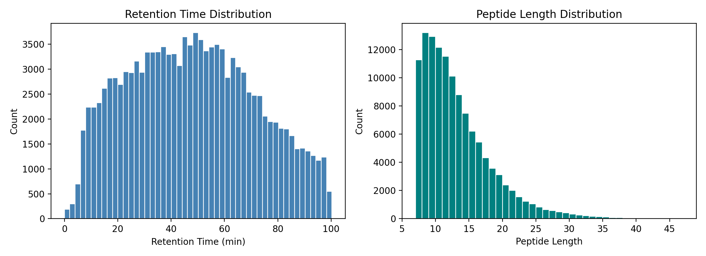

# Peptide Retention Time Prediction Using Machine Learning

A mini machine learning project exploring peptide retention time prediction using classical machine learning and Transformer-based models.

## Overview

Peptide retention time (RT) is an important measurement in liquid chromatography–mass spectrometry (LC-MS). Predicting retention time from amino acid sequences can support peptide identification and proteomics analysis.

In this project, I explore three approaches:

- Random Forest Regression
- Support Vector Regression (SVR)
- Transformer-based Regression

The goal is to understand how different machine learning models handle peptide sequences and compare their predictive performance.

## Dataset

The dataset used in this project comes from the publicly available [AutoRT GitHub repository](https://github.com/bzhanglab/AutoRT).

Each sample contains a peptide sequence (`x`) and its corresponding retention time (`y`).

## Methodology

The project includes exploratory data analysis, feature representation, model training, and performance evaluation.

For the Transformer model, peptide sequences are tokenized into numerical representations, followed by embedding layers, Transformer encoders, and a regression head.

## Results

### Retention time EDA
The following figure shows the distributions of peptide retention times and sequence lengths in the training dataset.

**Figure 1.** Distribution of peptide retention times and sequence lengths in the AutoRT training dataset.

### Model comparison
Model comparisons and prediction visualizations will be added here.

## My Thoughts

This side project is for exploring how machine learning methods can be applied to biological sequence data.

One question I am particularly interested in is whether the additional complexity of Transformer models leads to meaningful improvements over traditional machine learning methods.

## Acknowledgements

This is an independent exploratory project using data from the AutoRT repository. The models implemented here are not intended to reproduce the original AutoRT architecture.

Original project: [AutoRT](https://github.com/bzhanglab/AutoRT)